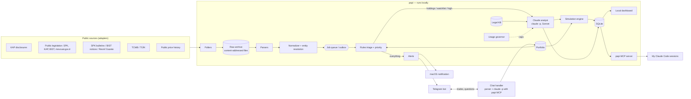
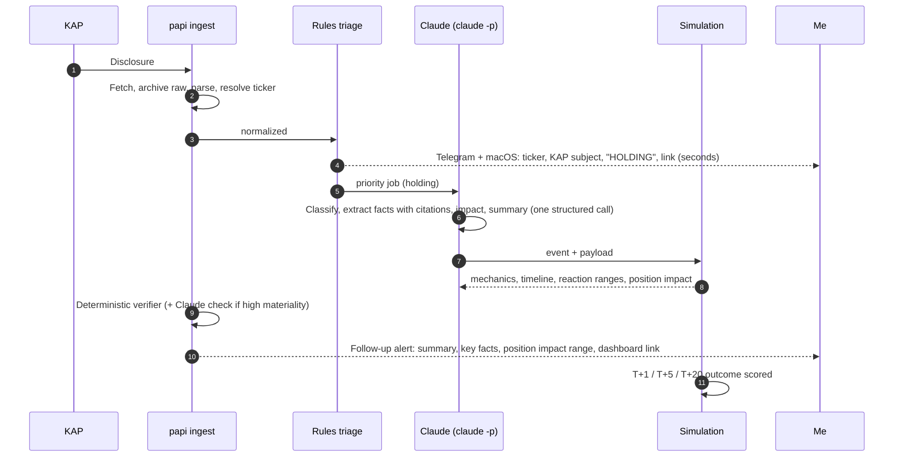

# PRD — papi

| Field | Value |
|---|---|
| Product | **papi** — personal BIST disclosure intelligence |
| Status | Draft v0.2 (re-scoped to personal, local use) |
| Owner / only user / only developer | Yağız Özcan |
| Last updated | 2026-10-28 |
| Subsystem docs | [`docs/prd/`](docs/prd/) |

---

## 1. Summary

Every company listed on Borsa İstanbul (BIST) must publish material information on **KAP** (Kamuyu Aydınlatma Platformu, operated by MKK). KAP indexes roughly **~440 disclosures per calendar day** on average. This is an estimate from `disclosureIndex` growth between Dec 2023 and Oct 2026; it includes funds and spikes in financial-reporting season. The disclosures are Turkish legal forms, PDFs, spreadsheets and XBRL files.

**papi** runs on my own machine and:

1. **Captures** every KAP disclosure, plus public regulator and macro signals (SPK, Borsa İstanbul, Resmî Gazete, TCMB, TÜİK), as fast as polite polling allows. Nothing is lost, and the origin of every item is recorded.
2. **Understands** what matters to *me*. It classifies everything with rules. It then spends Claude usage (Claude Code CLI, Sonnet, my subscription) on disclosures that touch my holdings or watchlist, or that look market-moving. Analysis is grounded in the public legal framework (SPK law, communiqués, KAP and BIST rules) that papi fetches and versions itself.
3. **Simulates** what may happen next:
   - mechanical consequences, e.g. theoretical ex-rights price, dilution, my new share count;
   - the regulatory timeline the event triggers;
   - calibrated price and volume reaction ranges based on similar past events, translated into the TRY impact on **my position and portfolio**.
4. **Talks with me on Telegram**:
   - Instant alerts for my holdings, plus macOS notifications at the desk.
   - I can message it "THYAO 100 lot 285,40'tan aldım" to record a trade (after a ✅ confirmation).
   - I can ask "ASELS alsam ne olur?" or "bugün portföyümde ne oldu?" and get evidence-based answers.
   - Also: a local dashboard, a daily digest, and an MCP server for my Claude Code sessions.

papi is a single-user personal tool. Nothing is redistributed. The architecture still keeps the future open:

- The core is market-agnostic; Turkey is the first *jurisdiction pack*.
- Storage, queue, LLM and notifier sit behind interfaces.
- Moving to an always-on host, a different LLM backend, or a multi-user product is an adapter or config change, not a rewrite. What would be required to go public is listed in [10 §5](docs/prd/10-usage-boundaries.md#5-if-papi-ever-goes-beyond-personal-use).

## 2. Problem (mine)

| Pain | Consequence |
|---|---|
| I can't read 400+ Turkish disclosures a day | I learn about material news on my holdings late, from social media, distorted |
| KAP has no prioritisation, no "this affects you" view | Routine filings drown the important ones |
| Context is manual | "Is this contract big vs. revenue? What did the stock do last time they announced a bedelli? What does it mean for my share count?" |
| No memory | I can't easily look back at how events played out, or whether my own read was right |

## 3. Goals and non-goals

### 3.1 Goals

| ID | Goal | Measured by |
|---|---|---|
| G1 | **Never miss a disclosure on my holdings** | 100 % of holdings/watchlist disclosures alerted; every KAP index gap detected and caught up |
| G2 | **Fast** (while machine is awake) | KAP publish → phone alert for holdings p95 ≤ 60 s; full analysis p95 ≤ 3 min |
| G3 | **Trustworthy** | Extraction accuracy ≥ 95 % on my reviewed set for top event types; every fact links to the source span |
| G4 | **Honest simulation** | Every forecast frozen before the outcome; calibration tracked per event family |
| G5 | **Portfolio-aware** | Each relevant event shows impact on my position (shares, TRY value range, portfolio weight) |
| G6 | **Lives within my Claude subscription** | papi never starves my interactive Claude Code work. A configurable share cap and automatic pause-on-limit enforce this. |
| G7 | **Future stays open** | New source = new adapter; new market = new pack; new host / LLM backend = config |

### 3.2 Non-goals

- Order execution, broker integration, auto-trading.
- Multi-user features, accounts, public API, public website.
- Redistribution of KAP content or price data to anyone else.
- Real-time order-book / tick analytics.
- Non-public data of any kind. **Public information only is a hard rule.**

## 4. The single user

**Me, as a BIST investor.**
- Primary jobs: "Alert me immediately when something material happens to what I own or watch. Tell me what it means for my position, with evidence, and what usually happens next."
- Secondary jobs: "Let me research event types historically. Let me ask questions in Claude Code over everything papi has collected."

## 5. Principles

1. **Source is king.** The original KAP disclosure is always one click away.
2. **Every claim is cited; every forecast is scored.**
3. **Numbers come from documents, calculators and statistical models; words come from Claude.** Claude extracts and explains. It does not invent prices or probabilities.
4. **Point-in-time correctness.** Bitemporal storage; backtests never see the future.
5. **Raw first, reprocess forever.** Every fetched byte is archived; history can be re-run with better parsers and prompts.
6. **Rules first, Claude where it pays.** Deterministic code handles everything it can; subscription usage is spent by priority.
7. **Decision support, not autopilot.** papi shows evidence and ranges. Decisions and trades stay mine.
8. **Market-agnostic core, jurisdiction packs at the edge.**

## 6. System overview



## 7. Core flow



## 8. Functional areas

| Area | Requirement summary | Doc |
|---|---|---|
| Sources | Public-only adapters; registry with access notes, cadence, health | [01](docs/prd/01-data-sources.md) |
| Ingestion | Lossless, idempotent, gap-detecting, catch-up after sleep, revision-aware | [02](docs/prd/02-ingestion-pipeline.md) |
| Legal KB | Public legislation fetched, versioned, article-level citations, point-in-time | [03](docs/prd/03-regulatory-knowledge-base.md) |
| Agents | Rules triage + Claude Code CLI analyst + verifier; usage governor; priority queue | [04](docs/prd/04-agents.md) |
| Simulation | Mechanics, regulatory timelines, event-study reactions, position/portfolio impact, outcome scoring | [05](docs/prd/05-simulation-engine.md) |
| Data model | Market-agnostic, bitemporal, versioned contracts; SQLite now, Postgres-ready | [06](docs/prd/06-data-model.md) |
| Dashboard | Local web UI: feed, detail, company, portfolio, event studies, track record, ops | [07](docs/prd/07-dashboard.md) |
| API, MCP, alerts, chat | Local HTTP API, MCP server for Claude Code, Telegram + macOS notifications, digests; two-way Telegram chat for trade recording, what-ifs and questions | [08](docs/prd/08-local-api-mcp-and-notifications.md) |
| Runtime | Single local process, launchd, backups, observability, future hosting path | [09](docs/prd/09-platform-infrastructure.md) |
| Boundaries | Personal-use limits, scraping etiquette, subscription use, going-public checklist | [10](docs/prd/10-usage-boundaries.md) |
| Quality | Small reviewed golden sets, eval command, calibration | [11](docs/prd/11-evaluation-and-quality.md) |
| Portfolio | Holdings, transactions, corporate-action adjustments, exposure, impact | [12](docs/prd/12-portfolio.md) |
| Terms | TR ↔ EN glossary | [Glossary](docs/prd/glossary.md) |

## 9. Success metrics

| Metric | Target |
|---|---|
| Holdings/watchlist disclosures alerted | 100 % |
| Publish → first alert (awake) | p95 ≤ 60 s |
| Catch-up after wake/restart | All missed disclosures processed ≤ 5 min after resume |
| Extraction accuracy on reviewed set | ≥ 95 % |
| Facts with resolvable citation | ≥ 99 % |
| papi share of Claude usage | Within configured cap; zero times papi caused me to hit a limit while coding |
| Forecast interval coverage | Within ±5 pp of nominal once ≥ 100 matured forecasts per family |
| My own weekly KAP reading time | Down to "read papi digest + flagged items" |

## 10. Milestones

Solo project: milestones are ordered by value and gated by exit criteria, not dates. **Each milestone leaves a usable tool.**

| Milestone | Scope | Exit criteria |
|---|---|---|
| **M0 Skeleton** | Repo, `papi` CLI, SQLite schema + migrations, contracts package, TR pack skeleton, portfolio entry (manual + papi CSV template) and İşCep reconcile | `papi init && papi portfolio add` works |
| **M1 Capture + alerts** | KAP poller, raw archive, body/PDF parsers, issuer master, gap detection + catch-up, rules-based headline alerts to Telegram/macOS for holdings & watchlist; **Telegram trade recording + commands** (deterministic parser, ✅ confirmation) | 14 days: zero missed holdings disclosures, p95 alert ≤ 60 s awake; trades logged from Telegram |
| **M2 Understand** | Public legal corpus fetch → KB; Claude analyst for top event types; verifier; usage governor; minimal dashboard (feed + detail) | ≥ 95 % extraction on reviewed set; governor proven under a simulated burst |
| **M3 Simulate** | Price-history adapter, corporate-action adjustment, calculators, event-study engine, forecasts + outcome tracker | Walk-forward backtest ≥ 3 years with no knowledge-time violations |
| **M4 Portfolio intelligence** | Portfolio page, position/portfolio impact, daily digest, MCP server, **Telegram chat Q&A + "alsam ne olur?" what-ifs** | Every holdings event shows position impact; MCP usable from Claude Code; chat answers with cited events |
| **M5 More sources** | SPK bülten, BIST notices, Resmî Gazete, TCMB/TÜİK, spillover (suppliers/customers/subsidiaries) | Each source has gap/freshness monitoring |
| **Later** | Always-on host (mini PC / VPS), intraday prices, second market pack, going-public track | — |

## 11. Risks

| Risk | Impact | Mitigation |
|---|---|---|
| **KAP site changes** (unofficial JSON endpoints behind the public SPA) | Capture breaks | `KapClient` interface; schema-drift alerts; raw archive allows reparse; official KAP API client remains a drop-in option |
| **Being rate-limited/blocked by KAP WAF** | Capture breaks | Conservative cadence, single connection, honest User-Agent, backoff and circuit breaker. KAP says high-volume use belongs on its API, so papi stays low-volume ([10](docs/prd/10-usage-boundaries.md)). |
| **Laptop asleep / offline** | Late alerts | Gap detection + catch-up on wake; "late (catch-up)" label; optional always-on host later |
| **Claude usage limits** (5-hour and weekly limits shared with my interactive use) | Analyses delayed; my coding blocked | Usage governor with papi share cap, priority queue, pause-on-limit, rules-only fallback, off-hours backlog |
| **Claude Code CLI behaviour changes** | Agent calls break | One wrapper module; JSON-schema output validation; contract test against live CLI on each upgrade |
| **Unofficial price sources** wrong/missing (esp. corporate-action adjustments) | Bad simulations | Two-source cross-check; own adjustment from KAP corporate actions; anomaly checks |
| **Hallucinated facts** | Wrong decisions | Schema-constrained extraction; citations required; deterministic verifier; numbers never from free text |
| **Look-ahead bias** | False confidence | Bitemporal store; point-in-time features; frozen forecasts |
| **Scope creep for a solo dev** | Never finish | Milestones each ship standalone value; future agents are explicitly deferred |

## 12. Decisions taken (from owner answers, 2026-10-28)

| Topic | Decision |
|---|---|
| Team | Solo |
| Budget | Existing Claude subscription only. No paid data, no paid hosting. |
| Business model | None; personal portfolio use |
| Licences | None acquired. Public sources at personal, low volume; no redistribution ([10](docs/prd/10-usage-boundaries.md)) |
| LLM | Claude Code CLI headless (`claude -p`), Sonnet (alias `sonnet`, resolved model id pinned in config) |
| Hosting | Local Mac. Always-on host is a later, optional step using the same artefacts |
| Legal corpus | Public legislation fetched by papi from official sites |
| Name | **papi** |
| Broker | İşCep (İş Yatırım). **No integration**: no API, no account login, no statement scraping ([12 §2](docs/prd/12-portfolio.md#2-inputs)) |
| Trade log | **I tell papi every buy and sell on Telegram**; papi stores them (after ✅) as the system of record for my holdings. CSV template only for the initial load; reconcile against İşCep occasionally ([08 §4.3](docs/prd/08-local-api-mcp-and-notifications.md#43-trade-recording)) |
| Claude plan | **Max 5x**. Governor starts with the Max 5x profile and is calibrated in week 1 ([04 §6](docs/prd/04-agents.md#6-usage-governor)) |
| Phone | **Telegram** bot: alerts, trade recording, questions (+ macOS notifications at the desk) |
| Verdicts | **No "al/sat" verdicts, no target prices.** papi answers with evidence, what-if numbers and event-based ranges; decisions stay mine ([08 §4.4](docs/prd/08-local-api-mcp-and-notifications.md#44-should-i-buy-x--what-papi-answers)) |

## 13. Remaining open questions

None blocking. New questions get added here as they come up during the milestones.

## 14. Document map

```
PRD.md                                     ← this file
docs/prd/
  01-data-sources.md                       sources, access notes, adapter interface
  02-ingestion-pipeline.md                 poll → raw → parse → normalize → queue; catch-up
  03-regulatory-knowledge-base.md          public legislation → versioned, citable KB
  04-agents.md                             rules triage, Claude Code CLI analyst, verifier, usage governor
  05-simulation-engine.md                  mechanics, timelines, reactions, position impact, scoring
  06-data-model.md                         entities, taxonomy, contracts, storage
  07-dashboard.md                          local web UI
  08-local-api-mcp-and-notifications.md    local API, MCP server, alerts, digests, Telegram chat (trades, what-ifs, Q&A)
  09-platform-infrastructure.md            local runtime, stack, ops, future hosting
  10-usage-boundaries.md                   personal-use rules; going-public checklist
  11-evaluation-and-quality.md             golden sets, eval command, calibration
  12-portfolio.md                          holdings, transactions, corporate actions, exposure
  glossary.md                              TR ↔ EN terms
```

## 15. References (verified 2026-10-28)

- KAP Veri Yayın Servisi REST API (official): https://kap.org.tr/tr/api/about/content-file/8a019492945fbe080194b26d8bed4873
- Community notes on KAP public JSON endpoints (unofficial): https://github.com/caganco/trailingedge/blob/master/docs/KAP_ENDPOINT_NOTES.md
- SPK — Borsa şirketlerinin yükümlülükleri: https://spk.gov.tr/sirketler/duzenlemeler-ve-surecler/borsa-sirketlerinin-yukumlulukleri
- Claude Code headless mode (`-p`, `--output-format json`, `--json-schema`; `--bare` does not use subscription login): https://code.claude.com/docs/en/headless
- Claude Code CLI reference: https://code.claude.com/docs/en/cli-reference
- Claude Code with Pro/Max (5-hour + weekly limits shared with Claude apps; `ANTHROPIC_API_KEY` overrides subscription): https://support.claude.com/en/articles/11145838-use-claude-code-with-your-pro-or-max-plan
- `isyatirimhisse` (İş Yatırım data; author states personal use only): https://pypi.org/project/isyatirimhisse
