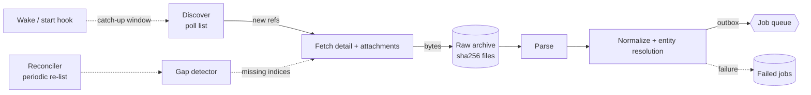

# 02 — Ingestion Pipeline

> Parent: [PRD.md](../../PRD.md) · Sources: [01](01-data-sources.md) · Contracts: [06](06-data-model.md) · Runtime: [09](09-platform-infrastructure.md)

## 1. Goals

| ID | Goal | Target |
|---|---|---|
| ING-G1 | Completeness | Every KAP `disclosureIndex` seen while running; every gap (including sleep/offline periods) detected and caught up |
| ING-G2 | Latency (awake) | KAP publish → `disclosure.normalized` p95 ≤ 45 s, p50 ≤ 20 s |
| ING-G3 | Catch-up | After wake/restart, all missed items normalized ≤ 5 min (normal days) |
| ING-G4 | Losslessness | Every fetched byte archived; any stage re-runnable from raw |
| ING-G5 | Idempotency | No duplicates; revisions linked |
| ING-G6 | Low footprint on KAP | Single connection, conservative cadence, backoff; personal-volume traffic only |

## 2. Stages

| Stage | Responsibility | Failure handling |
|---|---|---|
| **Discover** | Poll the KAP disclosure list for a rolling window; diff against known indices | Jittered backoff; circuit breaker on WAF/5xx; health alert |
| **Fetch** | Detail JSON, body, every attachment | ≤ 5 retries with backoff, then failed-job record + gap marker |
| **Parse** | Bytes → `document` (text, tables, form fields, spans) | Exception → failed job; never blocks other items |
| **Normalize** | Map to `disclosure`; resolve issuers/instruments; link revisions; rule-based taxonomy pre-label | Unresolved entity → keep, flag `issuer_resolution=pending` |
| **Gap detect** | `disclosureIndex` is monotonic, so missing integers are gaps | Auto-fetch by index; surfaced in ops view if unresolved |
| **Reconcile** | Re-list the last 48 h every few hours to catch corrections, blocks and late items | Scheduled |

## 3. KAP specifics

### 3.1 Polling and catch-up

- **Cadence is config**, session-aware via `trading_calendar`: e.g. every 20–30 s during the trading session and the evening disclosure peak after close, every 2–5 min overnight and on weekends. Defaults are conservative and tuned only if KAP responds well.
- **One request at a time** to kap.org.tr, through a global rate limiter, with an honest `User-Agent`.
- **Wake/start catch-up**: on process start or macOS wake, papi reads `last_seen_index` and `last_poll_at`, lists the missed date window (in chunks under the ~2000-row list cap), then fetches detail for missing indices. Holdings and watchlist items are fetched first.
- **Catch-up alerts are labelled `late (catch-up)`** with the original publish time, so I know the timing context.

### 3.2 Revisions and takedowns

- Corrections/updates (`relatedDisclosureOid`, `modifyStatus`, `isChanged`) create a new `disclosure` with `revision_of`. The old events are marked `superseded_by`, analysis re-runs, and a revision alert is sent if the original was alerted.
- Blocked disclosures (`isBlocked`): marked `blocked`, hidden in UI by default; raw kept locally.

### 3.3 Parsing

| Content | Approach |
|---|---|
| ÖDA/DKB HTML forms | Template-aware parsers keyed by form CSS class/template id. Unknown template → generic table extraction + `template_unknown` flag in ops view. |
| Free-text "Açıklamalar" | Paragraph and sentence spans (Turkish-aware) for citation |
| PDF attachments | Unwrap the Java-serialised `byte[]` → PDF; text layer first; OCR fallback (Turkish) only when there is no text layer; table extraction; page + bbox spans; handle cp1254/ISO-8859-9 |
| XLS/XLSX/DOC | Convert to tables/text; sheet/cell coordinates as spans |
| XBRL | Parse to canonical financial line items (period, consolidation basis) |
| EN versions | Separate `document` with `language=en`, linked to the TR original; TR is authoritative |

Parsers are versioned and reproducible from raw. Golden fixtures per template live in the repo.

### 3.4 Entity resolution

1. `stockCode` / `relatedStocks` → `identifier(TICKER)` valid at `published_at`.
2. Fallback: `mkkMemberOid` → `identifier(KAP_MEMBER_OID)`.
3. Fallback: Turkish-normalised fuzzy legal-name match; below threshold → pending.
4. Issuer master synced daily from the KAP company list; changes (ticker/name changes, delistings) recorded bitemporally.

## 4. Non-functional requirements

| ID | Requirement |
|---|---|
| ING-N1 | **Idempotency**: raw keyed by sha256; disclosure unique on (`source_id`, `source_ref`). |
| ING-N2 | **Outbox**: DB write and job enqueue in the same SQLite transaction; consumers dedupe on job/event id. |
| ING-N3 | **Isolation**: live, catch-up, backfill and reparse are separate queues with separate rate budgets; live and holdings always win. |
| ING-N4 | **Never wait on Claude**: alerts and feed items publish from rules; analysis follows asynchronously. |
| ING-N5 | **Politeness**: circuit breaker on 4xx/5xx spikes or WAF responses (e.g. non-standard status codes); exponential backoff; no parallel requests. |
| ING-N6 | **Clock**: latency = our `first_seen_at` − source `published_at` (system clock NTP-synced by macOS). |
| ING-N7 | **Schema drift detection**: list/detail JSON validated against recorded schemas; missing required fields alert; HTML template fingerprints tracked. |
| ING-N8 | **Reprocess command**: `papi reparse --source kap --from … --to … [--template …]` re-runs parse/normalize and emits revisions only where output changed. |
| ING-N9 | **Retention**: raw kept indefinitely (local disk + backup, [09](09-platform-infrastructure.md)). |

## 5. Backfill

- One-off, resumable, rate-limited history load: holdings and watchlist issuers first (full history), then the whole market back to a configured start date (e.g. 2015) for event studies.
- Runs at a lower cadence than live polling, pauses automatically when live polling needs the connection, and can be limited to night hours.
- Progress cursor persisted; safe to stop and resume.

## 6. Observability (local)

| Signal | Where |
|---|---|
| Ingest latency histogram, last successful poll, open gaps, failed jobs, unknown templates, drift alerts | Ops page in dashboard ([07](07-dashboard.md)) |
| Daily reconciliation: our count vs. KAP list count per day | Ops page + digest footer if non-zero diff |
| Health alerts (poller down > 10 min during session, drift detected, circuit open) | Telegram "papi-ops" message |

## 7. Acceptance criteria

- [ ] 14 consecutive days: zero missed holdings/watchlist disclosures; p95 latency target met while awake.
- [ ] Sleep the Mac for 8 h, wake → all missed disclosures processed in ≤ 5 min; holdings alerts flagged `late (catch-up)`.
- [ ] Kill the process mid-fetch → restart yields no lost or duplicated disclosures.
- [ ] Re-parse of 1 month with a new parser version emits revisions only where outputs differ.
- [ ] A correction re-runs analysis and sends a revision alert.
