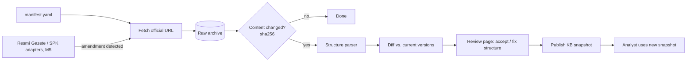

# 03 — Regulatory Knowledge Base

> Parent: [PRD.md](../../PRD.md) · Contracts: [06 §7](06-data-model.md#7-legal-knowledge-entities) · Consumers: [04](04-agents.md), [05](05-simulation-engine.md)

## 1. Purpose

Analysis must use **the rules as they stood on the disclosure date** and cite them at article level. papi fetches the public legislation itself from official sites, structures it, versions it, and serves it to the analyst and the simulation engine.

| Capability | Example |
|---|---|
| Legal basis | "Filed under the inside-information obligation of II-15.1." |
| Timelines | Bedelli: board decision → SPK application → approval in bulletin → rights period → new shares trade |
| Mechanics | Rights-issue / bonus-issue rules, tender-offer price rules, dividend rules, price-limit rules |
| Flags | Late filing; missing required fields |
| Learning | Regulation browser linked to real disclosures |

## 2. Corpus manifest

The corpus is defined by a versioned manifest in the TR pack (`packs/tr/legal/manifest.yaml`). Each entry has `id`, `official_code`, `title`, `authority`, `kind`, `source_urls[]` (preferred first), `priority`, `refresh` (how often to check for changes).

**Initial manifest.** Codes and titles are confirmed from the fetched text and its Resmî Gazete reference at ingestion.

| Priority | Group | Documents |
|---|---|---|
| P0 | Disclosure core | II-15.1 Özel Durumlar Tebliği; Özel Durumlar Rehberi; KAP bildirim rules / Yönerge; 6362 SPKn (esp. disclosure, market-abuse articles) |
| P0 | Capital & distribution | VII-128.1 Pay Tebliği; II-18.1 Kayıtlı Sermaye Sistemi; II-19.1 Kâr Payı; II-22.1 Geri Alınan Paylar |
| P1 | Corporate transactions | II-23.1 Önemli Nitelikteki İşlemler ve Ayrılma Hakkı; II-23.2 Birleşme ve Bölünme; II-26.1 Pay Alım Teklifi |
| P1 | Reporting & governance | II-14.1 Finansal Raporlama; II-17.1 Kurumsal Yönetim |
| P1 | Exchange rules | Borsa İstanbul Pay Piyasası rules/procedures; market-measure (tedbir) procedures incl. VBTS; index ground rules |
| P2 | Other | 6102 TTK (relevant parts); 4054 Rekabet (merger thresholds); II-5.1 İzahname ve İhraç Belgesi |

Adding a document means adding a manifest row. No code change.

## 3. Structure

### 3.1 Hierarchy and stable citation IDs

`Kısım → Bölüm → Madde → Fıkra → Bent → Alt bent` → `provision` rows with stable IDs:

```
tr:spk:II-15.1:m5:f1:a              II-15.1, Madde 5, Fıkra 1, Bent (a)
tr:law:6362:m107:f2                 SPKn Madde 107, Fıkra 2
tr:spk-guide:ozel-durumlar:II.1     Özel Durumlar Rehberi, Section II.1
```

IDs never change; renumbering by amendment records `renumbered_from`.

### 3.2 Point-in-time versions

- `provision_version` has `effective_from`, `effective_to`, `amended_by` (Resmî Gazete date/number or Board decision), `recorded_at`.
- Consolidated texts list their amendments in the header ("Tebliğ değişikliklerine ilişkin liste"). papi parses that list to date versions.
- When only today's consolidated text is available, older versions are reconstructed lazily, only for provisions that matter (obligations used by top event types). Otherwise the version is marked `effective_from_unknown`, and analyses of older events show a "law version uncertain" note.
- Retrieval **requires `as_of`**; the analyst passes the disclosure's `published_at`.

### 3.3 Obligations layer

Structured "who must disclose what, when, and what follows", used by verifier and simulation:

| Field | Example |
|---|---|
| `provision_id` | `tr:spk:II-15.1:m…` |
| `actor` | issuer / insider / shareholder crossing a threshold / board |
| `trigger` | e.g. ownership crossing a threshold, board resolution on capital increase |
| `event_codes[]` | `ownership.threshold_crossing` |
| `deadline_rule` | `immediately` / `by_next_session_open` / `within_n_business_days(n)` |
| `required_fields[]` | Fields a compliant disclosure contains |
| `downstream_steps[]` | Expected follow-on events (→ timelines in [05](05-simulation-engine.md)) |

Obligation rows are drafted by Claude from provision text (one-off, low volume) and **approved by me** in the KB review page. Only approved rows are used. Scope: top event types first ([04 §7](04-agents.md#7-top-event-types-for-v1)).

## 4. Fetch → publish workflow



| ID | Requirement |
|---|---|
| KB-1 | Fetch PDF/HTML/DOCX from manifest URLs; archive raw; skip unchanged content (sha256). |
| KB-2 | Parser recognises Turkish numbering ("MADDE 5 –", "(1)", "a)", "1)"); low-confidence structure is flagged for review. |
| KB-3 | Every published state is an immutable `kb_snapshot`; every analysis records the snapshot it used. |
| KB-4 | Periodic refresh per manifest `refresh`; a change creates a draft snapshot and a notification. |
| KB-5 | TR authoritative. EN translations (Claude-generated, on demand) are marked "unofficial translation" and cached per provision version. |
| KB-6 | Provenance: each provision version links to its source document span. |

## 5. Retrieval

| Aspect | Design |
|---|---|
| Preferred path | **Structured**: `event_code → obligations → provisions` (deterministic, no search needed) |
| Fallback | Full-text search (SQLite FTS5 over Turkish-normalised text: lowercasing with Turkish rules, diacritic folding, simple suffix stemming) + optional local embeddings (`sqlite-vec`, multilingual model) |
| Filters | `as_of`, authority, kind |
| Output | Provision text + `citation_id` + `provision_version_id` + effective dates |
| Prompt use | Only the few relevant provisions are inserted into the analyst prompt; never whole documents (saves subscription usage) |

## 6. Interfaces

```text
kb.lookup(citation_id, as_of) -> ProvisionVersion
kb.search(query, as_of, filters, k) -> [ProvisionHit]
kb.obligations(event_code, as_of) -> [Obligation]
kb.timeline(event_code, as_of) -> [ExpectedStep]
kb.snapshot() -> kb_snapshot_id
```

## 7. Acceptance criteria

- [ ] All P0 manifest documents fetched, structured to fıkra/bent level, reviewed, published as `kb-001`.
- [ ] `kb.lookup` returns the correct version before/after a known amendment for ≥ 3 provisions.
- [ ] Approved obligations exist for every top event type.
- [ ] Refresh detects a changed document and produces a reviewable diff.
