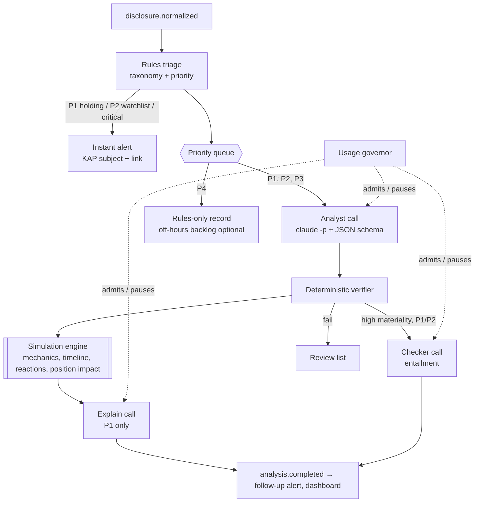

# 04 — Agents (Rules + Claude Code CLI)

> Parent: [PRD.md](../../PRD.md) · Inputs: [02](02-ingestion-pipeline.md), [03](03-regulatory-knowledge-base.md), [12](12-portfolio.md) · Calls: [05](05-simulation-engine.md) · Contracts: [06](06-data-model.md) · Quality: [11](11-evaluation-and-quality.md)

## 1. Stance

| Decision | Rationale |
|---|---|
| **Rules first, Claude second** | ~440 disclosures/day against a shared subscription. Deterministic code classifies everything; Claude is spent by priority. |
| **Few, fat, typed calls** | Each `claude -p` call has process start-up overhead and counts against usage. One structured "analyst" call does classification check + extraction + impact + summary, instead of 5 chained agents. |
| **Claude is a pure function** | No tools, no MCP, no file access in pipeline calls. Input is a prepared context pack; output is JSON validated against a schema. This also neutralises prompt injection from disclosure text. |
| **Numbers never originate in Claude** | Extracted numbers must cite a source span and are re-parsed deterministically. Ratios come from calculators, ranges from the simulation engine. |
| **Backend-agnostic** | `LlmBackend` interface; `ClaudeCodeCliBackend` is the default. Anthropic API, another provider or a local model can be added later without touching prompts or pipeline. |
| **Reproducible** | Every call stores the model id, prompt version, schema version, KB snapshot, input hash, raw JSON output and estimated cost. |

## 2. Pipeline



## 3. Rules triage (no LLM)

| Step | Logic |
|---|---|
| Taxonomy | TR-pack map: KAP `subject` + form template → candidate event code(s) ([06 §5.1](06-data-model.md#51-event-taxonomy)). Unmapped → `other.unclassified`. |
| Deterministic payload | For structured templates (dividend, capital increase, share transaction, buyback forms), fields are parsed directly from form tables; no LLM is needed for those fields. |
| Priority | **P1** issuer is a holding; **P2** on watchlist or index/sector I track; **P3** market-wide and rules materiality ≥ threshold (family prior × size heuristic × liquidity × novelty × flags); **P4** everything else. |
| Instant alert | P1/P2 always; P3 if family is in my "always tell me" list (e.g. `market.measure` on any XU030 name). Alert text = ticker + KAP subject/summary + materiality guess + KAP link. |
| Latency | ≤ 2 s after normalize |

## 4. Claude calls

### 4.1 Analyst (P1–P3)

| | |
|---|---|
| Input (stdin) | Context pack: disclosure text with **span markers** (`[S12] …`), parsed form fields, attachment excerpts; issuer snapshot (sector, market cap, TTM financials, last similar events); pre-computed ratios; relevant provisions from KB (`as_of` publish date); for P1: my position (shares, avg cost, weight). |
| Output (schema) | `event_codes[]` (confirm/override rules), `payload` per event-code schema with `span_ids` per field, `fundamental_channels[]`, `fundamental_direction` (`positive`/`negative`/`mixed`/`unclear`), `materiality` 0–100 + rationale, `claims[]` typed `fact`/`computation`/`inference` with span or citation ids, `summary_tr`, `summary_en`, `headline_tr`, `watch_next[]`, `confidence`. |
| Rules | Missing → `null`, never guessed. Currency/VAT explicit. Numbers copied verbatim from spans. |

### 4.2 Explain (P1 only)

After the simulation runs: a short TR narrative tying mechanics, timeline and reaction ranges to **my position** ("for 1,200 shares, P10–P90 T+5 range ≈ −₺X…+₺Y; the last 6 similar events at this issuer …"). It may only reference numbers present in its input; the verifier checks every number.

### 4.3 Checker (P1/P2 with materiality ≥ high)

A second, independent call. It receives each claim plus its cited span text and returns `supported` / `unsupported` / `partial` per claim. Unsupported claims are dropped from the UI and logged.

### 4.4 Off-hours backlog (optional)

The extraction-only variant of the analyst runs over P4 items and historical events of selected families (e.g. `business.contract.award`). It runs only inside configured night windows and under weekly headroom, and builds the conditioned event-study dataset for [05](05-simulation-engine.md) slowly.

### 4.5 Chat (Telegram, user-initiated)

Questions, what-ifs and free-form trade messages from Telegram. This is the only Claude call with tools: the read-only papi MCP server. Full spec: [08 §4](08-local-api-mcp-and-notifications.md#4-telegram-conversation).

## 5. Claude Code CLI backend

### 5.1 Invocation

```bash
cd ~/.papi/claude-sandbox && env -u ANTHROPIC_API_KEY claude -p \
  --model "$PAPI_MODEL_ANALYST" \
  --system-prompt-file "$PROMPTS/analyst.v3.md" \
  --tools "" \
  --strict-mcp-config --mcp-config '{"mcpServers":{}}' \
  --setting-sources project \
  --no-session-persistence \
  --max-turns 3 \
  --output-format json \
  --json-schema "$(cat "$SCHEMAS/analyst.v3.json")" \
  < context_pack.txt
```

| Flag / setting | Why |
|---|---|
| `cd ~/.papi/claude-sandbox` | Empty working dir: no project `CLAUDE.md`, `.mcp.json` or project hooks are picked up |
| `env -u ANTHROPIC_API_KEY` | If the key is set, Claude Code bills the API instead of the subscription |
| `--model` | Per-task model from config (default alias `sonnet`); the resolved model id is recorded per call |
| `--system-prompt-file` | Replaces the default Claude Code system prompt: smaller input, less usage, more deterministic |
| `--tools ""` | No built-in tools; Claude is a pure function |
| `--strict-mcp-config` + empty `--mcp-config` | No MCP servers from any other config |
| `--setting-sources project` | Loads only project settings, which in the empty sandbox means none; user-level hooks/settings stay out |
| `--no-session-persistence` | No transcripts piling up on disk |
| `--max-turns 3` | Hard cap on agent turns |
| `--output-format json` + `--json-schema` | Validated structured output in `structured_output`, plus cost metadata |

Notes (from Claude Code docs, verified 2026-10-28; flags `--json-schema`, `--model`, `--tools`, `--setting-sources`, `--strict-mcp-config`, `--no-session-persistence` confirmed in local `claude --help` v2.1.303; `--system-prompt-file` and `--max-turns` are in the CLI reference but not listed in `--help`, so they are checked in M2):
- `--bare` is **not** used: bare mode skips OAuth/keychain and requires `ANTHROPIC_API_KEY`, which would bypass the subscription.
- If `ANTHROPIC_API_KEY` is set in the environment, Claude Code uses it instead of the subscription, so the worker unsets it.
- With `--json-schema`, the result is in `structured_output`. It is **absent** if the run fails, so its presence is checked before use.
- The JSON output includes `total_cost_usd` and a per-model breakdown. These are client-side estimates that the governor uses as a usage proxy.
- Piped stdin is capped at 10 MB; context packs are far smaller (target ≤ 30k tokens).

**M2 verification item:** confirm on the installed CLI version that the sandbox flags load no user CLAUDE.md, hooks, skills or MCP servers, and record tokens per call. If something still leaks in, tighten the flags and re-measure.

### 5.2 Wrapper contract

```text
LlmBackend.complete(task, input_text, schema, model, max_turns) ->
  { structured_output | error, model_ids[], cost_usd_est, duration_ms, raw_json, exit_code }
```

- Exit code ≠ 0, missing `structured_output`, or schema-invalid output → one retry with a repair hint → otherwise failed job (listed in the review list).
- A rate-limit/usage-limit failure goes to the governor and is not retried immediately.
- Timeout per call (e.g. 180 s); SIGINT before SIGTERM.
- Concurrency: 1 process by default (configurable to 2).

## 6. Usage governor

The Claude subscription has a **5-hour session limit and a weekly limit, shared with my interactive Claude and Claude Code use**. papi must never be the reason I'm blocked while coding.

| Mechanism | Behaviour |
|---|---|
| Ledger | Each call records `cost_usd_est` + timestamp. Rolling 5 h and weekly sums. |
| Caps | `papi.share_5h` and `papi.share_week`, in cost-equivalent units (`cost_usd_est` sums). Calibrated once by comparing the ledger with claude.ai → Settings → Usage (see Max 5x profile below). |
| **Max 5x starting profile** | Week 1 (calibration): P1 + P2 only, papi target ≤ 10 % of the 5 h bar and ≤ 10 % of the weekly bar. I note the bar movement against the ledger sum to get "cost-equivalent per 1 % of bar". From week 2: `share_5h` = 15 % of the 5 h bar, `share_week` = 20 % of the weekly bar, P3 enabled, night backlog enabled only if the weekly bar is below 50 % on the day. Re-calibrate if Anthropic changes plan limits or the analyst model changes. |
| Admission by priority | Chat (my own Telegram questions) is admitted first within its own `share_chat_5h` bucket. Then P1 always until the hard cap; P2 below 80 % of the 5 h cap; P3 below 50 %. Backlog only in night windows and below a weekly threshold. |
| Limit hit | Usage-limit error → pause all Claude jobs until the reported/estimated reset; P1 items keep rules alerts and are marked `analysis pending (limit)`. |
| Focus mode | `papi llm pause [--for 3h]` / `resume`, or a schedule (e.g. weekdays 09:00–18:00: P1 only). |
| Burst mode | Reporting season: P3 automatically downgraded to rules-only. |
| Model routing | Per-task model in config (`analyst`, `explain`, `checker`, `backlog`). Default Sonnet everywhere; a cheaper model can be tried for checker/backlog after eval ([11](11-evaluation-and-quality.md)). |
| Visibility | Ops page: ledger charts, queue depth by priority, paused state, per-task average cost. |

## 7. Top event types for v1

Final order is decided from KAP subject frequencies **for my holdings** after M1.

| # | Code | # | Code |
|---|---|---|---|
| 1 | `business.contract.award` | 11 | `governance.gm.notice` / `.gm.result` |
| 2 | `capital.increase.bonus` | 12 | `governance.board.change` |
| 3 | `capital.increase.rights` | 13 | `legal.lawsuit` |
| 4 | `distribution.dividend.cash` | 14 | `legal.sanction` |
| 5 | `buyback.program.start` / `.execution` | 15 | `market.measure` |
| 6 | `ownership.insider_trade` | 16 | `finance.rating.change` |
| 7 | `ownership.threshold_crossing` | 17 | `finance.debt.issuance` |
| 8 | `mna.acquisition` / `.disposal` | 18 | `business.tender_result` |
| 9 | `report.financial.periodic` | 19 | `business.capex` |
| 10 | `report.financial.guidance` | 20 | `ownership.tender_offer` |

## 8. Prompts and versions

- Prompts and schemas live in the repo (`prompts/`, `packages/contracts/schemas/`). `agent_version` = hash(prompt, schema, model setting).
- Few-shot examples come only from my reviewed golden items, never from the eval test split.
- Disclosure text is always inside clearly delimited blocks and labelled as untrusted data.

## 9. Deferred agents (designed for, not built)

Spillover (suppliers/customers/subsidiaries/competitors), macro (TCMB/TÜİK → sector sensitivity), financial-report deep dive (XBRL KPI deltas vs. peers), disclosure-pattern anomalies. Interactive Q&A is covered by the Telegram chat ([§4.5](#45-chat-telegram-user-initiated)) and the MCP server in Claude Code ([08](08-local-api-mcp-and-notifications.md)).

## 10. Acceptance criteria

- [ ] Rules triage maps ≥ 90 % of disclosures to a non-`other` code.
- [ ] Analyst schema, prompt and golden set exist for each of the first 10 event types; field accuracy ≥ 95 %.
- [ ] Every number in summaries/explanations is traced by the verifier to a span, calculator or forecast.
- [ ] Governor test: simulated burst of 300 P3 + 5 P1 items keeps usage under the cap, and all P1 are analysed first.
- [ ] Usage-limit error pauses Claude jobs and resumes automatically, with no lost jobs.
- [ ] Swapping the analyst model is a config change; the eval command reports the difference.
