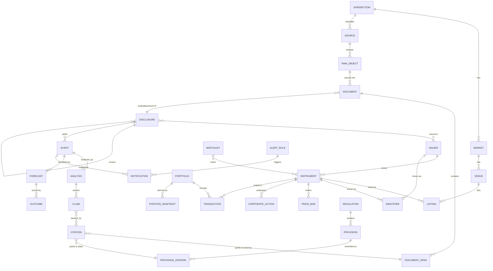

# 06 — Data Model & Event Contracts

> Parent: [PRD.md](../../PRD.md). This document is the **shared contract** for all other subsystem docs. Names defined here are canonical.
>
> Storage is SQLite in v1 ([§10](#10-storage-layout-local)). Types below are logical: `json` = JSON text (JSON1 functions; JSONB if moved to Postgres), `[]` = JSON array or join table, `timestamptz` = ISO-8601 UTC text. Access goes through a repository layer (SQLAlchemy Core + Alembic migrations), so a move to Postgres is a migration, not a rewrite.

## 1. Design rules

| Rule | Why |
|---|---|
| **Market-agnostic core.** No table or field named after KAP, BIST, or Turkey in the core schema. Turkey-specific data lives in `jurisdiction_pack`-scoped tables, taxonomies, and `source_payload` JSON. | Second market = new pack, no migration (Goal G7). |
| **Internal IDs are UUIDv7.** External identifiers (ticker, ISIN, KAP `mkkMemberOid`, `disclosureIndex`, LEI) live in an `identifier` table with validity periods. | Tickers change, companies merge, ISINs are re-issued. |
| **Bitemporal where facts change.** `valid_from/valid_to` (when true in the world) + `recorded_at/superseded_at` (when we knew it). | Point-in-time backtests; audit. |
| **Raw is immutable and content-addressed.** `sha256` of bytes is the key. | Reprocess forever; dedup; tamper evidence. |
| **Derived data carries provenance.** Every derived row links to its inputs, producer, producer version. | Reproducibility; debugging; legal defensibility. |
| **Versioned schemas.** JSON payloads carry `schema` + `schema_version`; breaking change = new major. | Agents and consumers evolve independently. |
| **Time is UTC in storage; `Europe/Istanbul` in presentation.** Source-local timestamps are preserved verbatim alongside. | KAP publishes `DD.MM.YYYY HH:MM:SS` local time. |

## 2. Entity map



## 3. Reference entities

| Entity | Key fields | Notes |
|---|---|---|
| `jurisdiction` | `id`, `code` (`TR`), `name`, `default_tz`, `default_currency`, `languages[]`, `pack_version` | A jurisdiction pack bundles sources, taxonomy mappings, legal corpus, calendars. |
| `market` | `id`, `jurisdiction_id`, `code` (`BIST_EQ`), `name`, `asset_class` | |
| `venue` | `id`, `market_id`, `mic` (ISO 10383, e.g. `XIST`), `name`, `calendar_id` | |
| `trading_calendar` | `id`, `date`, `session_type`, `open_utc`, `close_utc`, `is_half_day` | Loaded from official calendar; **never hard-code session times**. |
| `issuer` | `id`, `legal_name`, `short_name`, `country`, `sector_code`, `status` | Company, fund, bank, intermediary, regulator (regulators also "issue" notices). |
| `instrument` | `id`, `issuer_id`, `type` (`equity`, `warrant`, `bond`, `fund`, `etf`, …), `currency` | |
| `listing` | `instrument_id`, `venue_id`, `segment` (e.g. Yıldız/Ana/Alt Pazar — pack-defined), `valid_from`, `valid_to` | Segment changes are events too. |
| `identifier` | `entity_type`, `entity_id`, `scheme` (`TICKER`, `ISIN`, `KAP_MEMBER_OID`, `KAP_COMPANY_OID`, `LEI`, `MERSIS`, `VKN`), `value`, `valid_from`, `valid_to` | Unique on (`scheme`,`value`, validity range). Entity resolution reads this. |
| `index_membership` | `index_code` (`XU100`, `XU030`, …), `instrument_id`, `weight`, `valid_from`, `valid_to` | Point-in-time; drives benchmark selection and spillover. |
| `relationship` | `from_issuer_id`, `to_issuer_id`, `type` (`subsidiary`, `parent`, `supplier`, `customer`, `competitor`, `jv`), `source_claim_id`, `valid_from/to` | Built from disclosures over time; enables spillover analysis. |

## 4. Capture entities

| Entity | Key fields | Notes |
|---|---|---|
| `source` | `id`, `code` (`kap`, `legal_corpus`, `isyatirim_prices`, `yahoo_prices`, `spk_bulletin`, `bist_notices`, `resmi_gazete`, `tcmb`, `tuik`), `jurisdiction_id`, `access_mode` (`public_web`, `licensed_api`, `file_drop`), `rate_limit`, `terms_note`, `status` | Registry; see [01](01-data-sources.md). `licensed_api` is unused today but kept as a value. |
| `raw_object` | `sha256` (PK), `source_id`, `url`, `http_status`, `request_meta`, `response_headers`, `fetched_at`, `content_type`, `byte_size`, `storage_uri` | Immutable. Same bytes fetched twice → one object, two `fetch_log` rows. |
| `fetch_log` | `id`, `source_id`, `raw_sha256`, `fetcher_version`, `started_at`, `finished_at`, `outcome` | Ops + audit trail. |
| `document` | `id`, `raw_sha256`, `kind` (`disclosure_body`, `attachment`, `regulation`, `bulletin`), `mime`, `language`, `text`, `structure` (JSON: tables, form fields), `parser`, `parser_version`, `parsed_at` | Re-parsing creates a new row; latest-by-parser-version is "current". |
| `document_span` | `id`, `document_id`, `page`, `char_start`, `char_end`, `bbox?`, `field_path?` (e.g. form field id) | Atomic citation target. |
| `disclosure` | see §4.1 | Source-agnostic "official publication". |

### 4.1 `disclosure`

| Field | Type | Notes |
|---|---|---|
| `id` | uuid | |
| `source_id` | fk | |
| `source_ref` | text | KAP: `disclosureIndex` (string to stay generic) |
| `source_uid` | text | KAP: `disclosureId` (hex) — stable |
| `revision_of` | fk → disclosure | Set for corrections/updates (`relatedDisclosureOid`) |
| `revision_kind` | enum | `original`, `correction` (düzeltme), `update` (güncelleme), `blocked` |
| `published_at` | timestamptz | Source publish time (converted to UTC) |
| `published_at_raw` | text | Verbatim source string |
| `first_seen_at` | timestamptz | When our system first saw it — **latency KPI = `first_seen_at − published_at`** |
| `source_class` / `source_type` / `source_category` | text | KAP raw values (`ODA`, `FR`, `DG`, `DKB`, …) |
| `source_subject` | text | KAP subject string, e.g. "Özel Durum Açıklaması (Genel)", "Pay Alım Satım Bildirimi" |
| `title`, `summary` | text | Source-provided |
| `filer_issuer_id` | fk | Who filed (may be KAP/MKK itself for relayed forms) |
| `related_issuer_ids` | fk[] | Who it is about (`relatedStocks`) |
| `is_late` | bool | Source flag |
| `languages` | text[] | `tr`, `en` versions available |
| `body_document_id`, `attachment_document_ids[]` | fk | |
| `source_payload` | json | Full raw list+detail JSON, verbatim |
| `ingest_status` | enum | `seen` → `fetched` → `parsed` → `normalized` → `failed(stage)` |

## 5. Understanding entities

### 5.1 Event taxonomy

An **event** is a normalised, typed, market-agnostic fact derived from one or more disclosures. One disclosure can yield several events (e.g. a board decision announcing both a dividend and a buyback).

Codes are hierarchical, dot-separated, English, stable. The Turkey pack maps KAP subjects → codes; other packs map their own sources.

| Family | Example codes | Typical KAP origin (TR pack mapping, illustrative) |
|---|---|---|
| `capital` | `capital.increase.rights` (bedelli), `capital.increase.bonus` (bedelsiz), `capital.decrease`, `capital.registered_ceiling` | Sermaye artırımı/azaltımı ÖDA, SPK bülten approvals |
| `distribution` | `distribution.dividend.cash`, `distribution.dividend.stock`, `distribution.policy` | Kâr payı dağıtım işlemlerine ilişkin bildirim |
| `buyback` | `buyback.program.start`, `buyback.execution`, `buyback.program.end` | Geri alınan paylara ilişkin bildirim |
| `ownership` | `ownership.insider_trade`, `ownership.threshold_crossing`, `ownership.tender_offer`, `ownership.squeeze_out` | Pay alım satım bildirimi, pay alım teklifi |
| `business` | `business.contract.award`, `business.contract.termination`, `business.capex`, `business.capacity`, `business.new_market`, `business.tender_result` | Yeni iş ilişkisi, ihale süreci/sonucu, yatırım kararı |
| `mna` | `mna.acquisition`, `mna.disposal`, `mna.merger`, `mna.demerger`, `mna.jv` | Maddi duran varlık/iştirak alım-satımı, birleşme |
| `finance` | `finance.debt.issuance`, `finance.debt.restructuring`, `finance.rating.change`, `finance.loan` | Borçlanma aracı ihracı, derecelendirme |
| `report` | `report.financial.periodic`, `report.financial.guidance`, `report.activity`, `report.sustainability` | FR category, faaliyet raporu |
| `governance` | `governance.board.change`, `governance.executive.change`, `governance.gm.notice`, `governance.gm.result`, `governance.articles.change`, `governance.auditor.change` | Genel kurul, YK üye değişikliği |
| `legal` | `legal.lawsuit`, `legal.investigation`, `legal.sanction`, `legal.bankruptcy`, `legal.concordat` | Dava, idari para cezası, konkordato |
| `market` | `market.measure` (tedbir), `market.halt`, `market.segment.change`, `market.index.change`, `market.ipo`, `market.delisting` | Borsa İstanbul / SPK regulator notices (DKB/DUY) |
| `macro` | `macro.policy_rate`, `macro.inflation`, `macro.fx_regulation`, `macro.law_change` | TCMB, TÜİK, Resmî Gazete |
| `other` | `other.unclassified` | Must trend → 0; feeds taxonomy review |

Taxonomy is versioned (`taxonomy_version`); each code has a **JSON Schema for its payload** (see §5.3). Adding codes is non-breaking; renaming is breaking.

### 5.2 Core tables

| Entity | Key fields |
|---|---|
| `event` | `id`, `disclosure_ids[]`, `code`, `taxonomy_version`, `issuer_ids[]`, `instrument_ids[]`, `occurred_at` (when the real-world thing happened, if stated), `announced_at` (= disclosure `published_at`), `payload` (json, schema-validated), `payload_source` (`form_fields`/`analyst`), `payload_schema`, `materiality` (0–100), `materiality_band` (`low`/`medium`/`high`/`critical`), `priority` (`P1`–`P4`), `status` (`provisional`/`final`/`retracted`), `superseded_by` |
| `analysis` | `id`, `event_id`, `agent` (`analyst`/`explain`/`checker`/`backlog`), `agent_version`, `backend` (`claude_code_cli`), `model_ids[]`, `prompt_version`, `schema_version`, `kb_snapshot`, `input_hash`, `output` (json), `raw_output` (json), `confidence`, `latency_ms`, `cost_usd_est`, `priority` (`P1`–`P4`), `created_at`, `review_state` (`auto`/`flagged`/`approved`/`rejected`) |
| `llm_usage_ledger` | `id`, `analysis_id?`, `task`, `model_ids[]`, `cost_usd_est`, `duration_ms`, `outcome` (`ok`/`schema_fail`/`limit_hit`/`error`), `at` — feeds the usage governor ([04 §6](04-agents.md#6-usage-governor)) |
| `claim` | `id`, `analysis_id`, `text_tr`, `text_en`, `kind` (`fact`/`computation`/`inference`), `value?`, `unit?` |
| `citation` | `id`, `claim_id`, `target_type` (`document_span`/`provision_version`/`price_series`/`forecast`), `target_id`, `quote?` |
| `summary` | `event_id`, `lang`, `headline`, `body`, `analysis_id` |

Invariants:

- A `claim` of kind `fact` **must** have ≥ 1 citation to a `document_span` or `provision_version`.
- A `claim` of kind `computation` **must** cite its inputs and record the formula id.
- `inference` claims are allowed only inside fields explicitly typed as interpretation, and are rendered as such in UI.

### 5.3 Payload schema example — `business.contract.award`

```json
{
  "$id": "event.business.contract.award/1",
  "type": "object",
  "required": ["counterparty", "value", "currency"],
  "properties": {
    "counterparty":       { "type": "object", "properties": {
                              "name": {"type": "string"},
                              "issuer_id": {"type": ["string","null"]},
                              "is_related_party": {"type": ["boolean","null"]},
                              "is_public_sector": {"type": ["boolean","null"]} } },
    "value":              { "type": ["number","null"] },
    "currency":           { "type": ["string","null"], "pattern": "^[A-Z]{3}$" },
    "vat_included":       { "type": ["boolean","null"] },
    "duration_months":    { "type": ["number","null"] },
    "start_date":         { "type": ["string","null"], "format": "date" },
    "scope":              { "type": ["string","null"] },
    "is_framework":       { "type": ["boolean","null"] },
    "ratios": { "type": "object", "properties": {
        "value_to_ttm_revenue": { "type": ["number","null"] },
        "value_to_market_cap":  { "type": ["number","null"] } } }
  }
}
```

Unknown ≠ zero: absent facts are `null`, never guessed.

## 6. Market & simulation entities

| Entity | Key fields | Notes |
|---|---|---|
| `price_bar` | `instrument_id`, `ts`, `interval` (`1d` in v1), `open/high/low/close`, `volume`, `value_traded`, `limit_up?`, `limit_down?`, `source_id`, `cross_check` (`ok`/`mismatch`/`single_source`) | Raw (unadjusted) stored; adjustment factors separate. |
| `corporate_action` | `instrument_id`, `type`, `ex_date`, `factor`, `cash_amount?`, `source_event_id` | Drives adjusted series and mechanical sims. |
| `fx_rate`, `macro_series` | `series`, `ts`, `value`, `vintage` | Vintage = release version (bitemporal). |
| `feature_snapshot` | `instrument_id`, `as_of` (knowledge time), `feature_set_version`, `features` (json) | Point-in-time features; see [05](05-simulation-engine.md). |
| `forecast` | `id`, `event_id`, `instrument_id`, `model`, `model_version`, `created_at`, `horizon` (`T+1`,`T+5`,`T+20`), `target` (`abnormal_return`, `volume_ratio`, `volatility_ratio`), `distribution` (quantiles), `scenarios` (json), `position_impact` (json, holdings only), `frozen_hash` | **Immutable after creation.** |
| `outcome` | `forecast_id`, `realised_value`, `realised_at`, `scores` (`pinball`, `crps`, `in_interval`, `direction_hit`) | Filled by outcome tracker. |

## 7. Legal knowledge entities

See [03](03-regulatory-knowledge-base.md) for semantics.

| Entity | Key fields |
|---|---|
| `regulation` | `id`, `jurisdiction_id`, `kind` (`law`, `communique`, `guideline`, `directive`, `board_decision`, `exchange_rule`), `official_code` (e.g. `6362`, `II-15.1`), `title`, `issuer_authority`, `source_document_id` |
| `provision` | `id`, `regulation_id`, `path` (e.g. `m5/f1/a`), `citation_id` (stable, e.g. `tr:spk:II-15.1:m5:f1:a`), `heading` |
| `provision_version` | `id`, `provision_id`, `text`, `effective_from`, `effective_to`, `amended_by` (gazette ref), `recorded_at` |
| `obligation` | `id`, `provision_id`, `event_codes[]`, `actor`, `deadline_rule`, `required_fields[]` — structured "what must be disclosed, by whom, when" |

## 8. Portfolio & personal entities

Single user, so there is no `user` table. If papi ever goes multi-user, an `owner_id` column is added to the tables below ([10 §5](10-usage-boundaries.md#5-if-papi-ever-goes-beyond-personal-use)). Semantics: [12](12-portfolio.md).

| Entity | Key fields | Notes |
|---|---|---|
| `portfolio` | `id`, `name`, `base_currency` (`TRY`), `account_label?` (e.g. `İşCep`) | Several allowed (e.g. per account) |
| `transaction` | `id`, `portfolio_id`, `instrument_id`, `type` (`buy`, `sell`, `dividend_cash`, `bonus_shares`, `rights_subscription`, `rights_sale`, `split`, `fee`, `tax`, `transfer_in/out`, `opening_balance`, `reconcile_adjustment`), `trade_date`, `settle_date?`, `quantity`, `price`, `fees`, `tax`, `currency`, `source` (`manual`/`telegram`/`csv_template`/`reconcile`/`derived:<corporate_action_id>`), `chat_message_id?`, `note` | Append-only; corrections are reversing entries |
| `position_snapshot` | `portfolio_id`, `instrument_id`, `as_of`, `quantity`, `avg_cost_try`, `cost_basis_usd?`, `market_value_try?`, `weight?` | Derived, rebuildable from transactions + prices |
| `pending_action` | `id`, `portfolio_id`, `instrument_id`, `corporate_action_id`, `kind`, `status` (`expected`/`applied`/`dismissed`) | Bonus/rights/dividend detected from KAP that should change holdings; I confirm |
| `watchlist` | `id`, `name`, `instrument_ids[]`, `sectors[]`, `indices[]` | |
| `alert_rule` | `id`, `name`, `filter` (DSL, [08 §3](08-local-api-mcp-and-notifications.md#3-alert-rules)), `channels[]`, `quiet_hours`, `enabled` | |
| `notification` | `id`, `alert_rule_id?`, `event_id`, `kind` (`instant`/`follow_up`/`revision`/`digest`/`ops`), `channel`, `sent_at`, `delivered`, `error?` | |
| `feedback` | `id`, `target_type`, `target_id`, `kind` (`wrong_fact`, `wrong_type`, `not_material`, `helpful`), `comment` | Feeds review list and golden sets |
| `chat_message` | `id`, `telegram_chat_id`, `telegram_message_id`, `reply_to_id?`, `direction` (`in`/`out`), `text`, `sent_at` (Telegram time), `processed_at`, `intent` (`trade`/`what_if`/`question`/`alert_reply`/`command`), `related_event_id?`, `proposed_transaction?` (json), `status` (`proposed`/`confirmed`/`cancelled`/`answered`/`pending_limit`), `analysis_id?` | Telegram thread history; drives chat memory and trade confirmation ([08 §4](08-local-api-mcp-and-notifications.md#4-telegram-conversation)) |

## 9. Internal event contracts

v1 runs as one local process. Events travel through a **SQLite-backed job queue with a transactional outbox**, behind a small `EventBus` interface. NATS/Kafka can replace it later without changing producers or consumers. Envelope: [CloudEvents 1.0](https://cloudevents.io/) JSON. Type naming: `<domain>.<entity>.<verb>.v<major>`.

```json
{
  "specversion": "1.0",
  "id": "0192f1c4-...",
  "source": "ingest/kap",
  "type": "disclosure.normalized.v1",
  "subject": "disclosure/0192f1c3-...",
  "time": "2026-10-28T07:10:35.412Z",
  "datacontenttype": "application/json",
  "traceparent": "00-...",
  "data": { "disclosure_id": "0192f1c3-...", "source_ref": "1689001", "related_issuer_ids": ["..."] }
}
```

| Topic | Producer | Consumers | Payload essentials |
|---|---|---|---|
| `source.object.fetched.v1` | fetchers | parsers | `raw_sha256`, `source_id`, `url` |
| `disclosure.seen.v1` | discovery | fetchers, latency monitor | `source_ref`, `published_at` |
| `disclosure.normalized.v1` | normalizer | agents, feed, alerts | `disclosure_id`, issuers, `source_subject` |
| `disclosure.revised.v1` | normalizer | agents, UI, alerts | `disclosure_id`, `revision_of`, `revision_kind` |
| `disclosure.blocked.v1` | normalizer | UI, MCP | `disclosure_id` (hidden by default) |
| `ingest.gap.detected.v1` | gap detector | ops, backfill | `source_id`, missing refs |
| `event.classified.v1` | triage agent | feed, alerts, deep pipeline | `event_id`, `code`, `materiality_band` |
| `analysis.completed.v1` | orchestrator | UI, MCP, alerts | `event_id`, `analysis_ids[]` |
| `forecast.created.v1` | simulation | UI, outcome tracker | `forecast_id`, `event_id`, horizons |
| `outcome.recorded.v1` | outcome tracker | calibration, UI | `forecast_id`, scores |
| `alert.triggered.v1` | alert engine | notifier | `alert_rule_id`, `event_id` |
| `kb.version.published.v1` | KB admin | agents (cache bust) | `kb_snapshot` |

Rules: at-least-once delivery; **consumers are idempotent** (dedupe on CloudEvents `id`); the outbox row is written in the same transaction as the state change; jobs carry `priority` and `not_before` (used by the usage governor and night windows).

## 10. Storage layout (local)

Root: `~/.papi/` (configurable).

| Store | Holds | Notes |
|---|---|---|
| `papi.db` (SQLite, WAL mode) | All entities above, job queue, ledger | System of record; single writer process, concurrent readers |
| `raw/{sha256[0:2]}/{sha256}` (files) | `raw_object` bytes | Content-addressed, write-once; same key layout as S3 for a future move |
| FTS5 virtual tables in `papi.db` | Full-text over disclosures and law | Text indexed in Turkish-normalised form (Turkish-aware lowercasing: I→ı, İ→i; diacritic-folded copy; light suffix stemming) |
| `sqlite-vec` table (optional) | Embeddings of `document_span`, `provision_version` | Embedding model id stored per vector; only if FTS + structured lookup prove insufficient |
| `prices.parquet/` (optional) | Bulk historical bars for research notebooks | Exported from `price_bar`; the DB stays the source of truth |
| `backups/` | Nightly SQLite online backups + raw sync | See [09](09-platform-infrastructure.md) |
