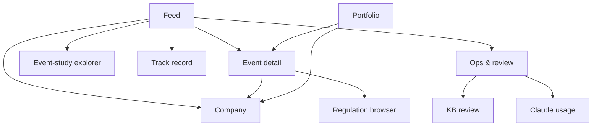

# 07 — Dashboard (local web UI)

> Parent: [PRD.md](../../PRD.md) · Data: [06](06-data-model.md) · API/alerts: [08](08-local-api-mcp-and-notifications.md) · Portfolio: [12](12-portfolio.md)

## 1. Principles

1. **My portfolio first.** Default views filter to holdings + watchlist; the whole market is one toggle away.
2. **Original first.** Every item links to the KAP page and shows publish time and how late papi saw it.
3. **Fact / computation / model / interpretation are visually distinct**, each with its own style and label.
4. **Uncertainty is shown**: ranges, "based on N analogues", provisional states, `analysis pending (limit)`.
5. **TR primary, EN toggle.**
6. **Boring tech, one language**: server-rendered pages from the Python app ([09 §2](09-platform-infrastructure.md#2-technology-decisions)), live updates via SSE, charts with a small JS charting library. No separate frontend build is needed in v1.

Served at `http://127.0.0.1:<port>` only. Optionally reachable from my phone over Tailscale later ([09](09-platform-infrastructure.md)).

## 2. Information architecture

## 3. Screens

### 3.1 Feed (home)

| Element | Behaviour |
|---|---|
| Stream | Reverse-chronological, live via SSE; "N new" pill when scrolled |
| Item | Istanbul time, ticker chip (with **HOLDING** / **WATCH** badge), event label, materiality, headline, status (`rules` → `analysed`), revision/late (catch-up) markers, KAP link |
| Default filter | Holdings + watchlist + P3 market-wide; toggle "all KAP" |
| Filters | Ticker, sector, index, event family, materiality ≥, source, "hide routine" |
| Bursts | Group floods ("23 financial reports in 5 min") with expand |
| Keys | `j/k` move, `/` search, `w` toggle watchlist, `o` open KAP |

### 3.2 Event detail

1. **Header**: issuer, ticker, event code, materiality, publish time, latency badge, KAP link, revision history.
2. **For me** (holdings only): position mechanics (new share count, cash needed, dividend cash), value range T+1/T+5/T+20 in TRY and as % of the portfolio, open timeline step.
3. **Summary**: TR/EN.
4. **Key facts**: payload table; hovering a value highlights its source span.
5. **Original**: side-by-side source viewer (HTML/PDF) with highlighted spans; attachments.
6. **Context**: size ratios, price chart with event markers, prior similar events at this issuer.
7. **Regulatory context**: legal basis and obligations with provision text as of the publish date; expected timeline.
8. **Scenarios**: mechanics, reaction fan chart vs. baseline, analogue list, model version.
9. **After the fact**: realised vs. forecast once horizons mature.
10. **Feedback**: wrong fact / wrong type / not material / helpful (feeds [11](11-evaluation-and-quality.md)).

### 3.3 Portfolio

See [12 §5](12-portfolio.md#5-portfolio-page). Holdings table with weights and P&L (TRY/USD/real), event timeline across holdings, open regulatory timelines, pending corporate actions to confirm, concentration view.

### 3.4 Company

Profile, identifier history, segment/index history, disclosure timeline, event-family heatmap, XBRL KPIs, insider and ownership activity, disclosure behaviour (late filings, corrections), my transactions overlaid on the price chart, forecast track record for this issuer.

### 3.5 Event-study explorer

Pick an event family and filters (period, sector, cap band, payload ranges) → average CAR curves with bands, distributions, and the list of underlying events. Used to build intuition and to sanity-check scenarios.

### 3.6 Regulation browser

Regulation → provision tree; version slider by date; "disclosures citing this provision".

### 3.7 Track record

Calibration plots, coverage, pinball loss vs. baseline by family/horizon/model version; worst misses.

### 3.8 Ops & review

| Area | Content |
|---|---|
| Ingestion health | Last poll, latency histogram, open gaps, failed jobs, unknown templates, drift alerts, daily reconciliation |
| Review list | Verifier failures, unsupported claims, pending entity resolution, unknown templates, my feedback items |
| KB review | Structure review, version diffs, obligation approval, publish snapshot |
| Claude usage | Ledger (5 h / week vs. caps), queue depth by priority, paused state, cost per task, pause/resume buttons |
| Taxonomy | KAP subject → code mapping editor; `other.unclassified` triage |

## 4. Non-functional

| ID | Requirement |
|---|---|
| UI-N1 | Feed renders ≤ 1 s locally; live item appears ≤ 1 s after its event |
| UI-N2 | Usable on phone-width screens (for the later Tailscale access) |
| UI-N3 | All copy in TR/EN catalogues |
| UI-N4 | No external calls from the browser except chart library assets (vendored locally) |

## 5. Acceptance criteria

- [ ] KAP publish → item visible in an open browser within the ingestion SLO + 1 s.
- [ ] Every fact on the detail page highlights its source span.
- [ ] Holdings events always show the "For me" block, or an explicit reason why not (e.g. no price data).
- [ ] Usage page numbers match the ledger exactly.
