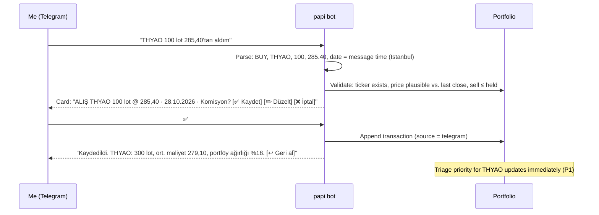

# 08 — Local API, MCP Server, Notifications & Telegram Chat

> Parent: [PRD.md](../../PRD.md) · Data: [06](06-data-model.md) · UI: [07](07-dashboard.md)

## 1. Local HTTP API

Bound to `127.0.0.1` only. The dashboard, scripts and notebooks use it. It is versioned (`/v1`) so a future multi-user/public API can grow from it.

| Endpoint | Description |
|---|---|
| `GET /v1/events?code=&ticker=&scope=&materiality_gte=&from=&to=&as_of=` | Events with payloads; `scope` ∈ `holdings`, `watchlist`, `all` |
| `GET /v1/events/{id}` | Event + analyses, claims, citations, forecasts, outcomes, position impact |
| `GET /v1/disclosures/{id}` | Disclosure, documents, revisions |
| `GET /v1/issuers/{id}` / `?ticker=` | Issuer master, identifiers, recent events |
| `GET /v1/portfolio` / `/positions` / `/transactions` | Portfolio data |
| `POST /v1/portfolio/transactions` / `POST /v1/portfolio/import` / `POST /v1/portfolio/reconcile` | Manual entry / papi CSV template import / reconcile against quantities read from İşCep ([12](12-portfolio.md)) |
| `GET /v1/event-studies?code=&filters…` | Aggregated reaction statistics |
| `GET /v1/regulations/{citation_id}?as_of=` | Provision text by date |
| `GET /v1/usage` | Claude usage ledger and governor state |
| `POST /v1/llm/pause` / `resume` | Governor control |
| `GET /v1/stream` | SSE: `event.classified`, `analysis.completed`, `forecast.created`, `disclosure.revised` |

No auth by default (loopback only). If exposed over Tailscale, a static bearer token from config is required.

## 2. papi MCP server

Lets my interactive Claude Code (or Claude Desktop) sessions query papi: "What happened to my holdings this week?", "Compare ASELS contract awards over the last 3 years", "Which of my stocks have open bedelli timelines?".

| Tool | Returns |
|---|---|
| `papi_search_events(query, ticker?, code?, scope?, from?, to?)` | Events with headline, codes, materiality, links |
| `papi_get_event(event_id)` | Full analysis, facts with citations, scenarios, position impact |
| `papi_portfolio()` | Positions, weights, open timelines, pending actions |
| `papi_holdings_digest(period)` | Structured digest of holdings events |
| `papi_event_study(code, filters)` | Aggregated reaction stats + analogues |
| `papi_regulation(citation_id, as_of)` | Provision text |
| `papi_search_disclosures_text(query, from?, to?)` | FTS over disclosure text with snippets |

Properties:
- **Read-only.** No tool mutates state; portfolio edits go through the UI/API.
- stdio transport, launched by Claude Code from `.mcp.json` / `claude mcp add`.
- Results include IDs and dashboard URLs, so answers stay traceable.
- These interactive sessions use my subscription like any Claude Code session. They don't go through papi's governor, because I'm driving them.

## 3. Alert rules

### 3.1 DSL

A small, safe filter language shared by alert rules, feed filters and MCP filters:

```text
scope = "holdings"
```

```text
watchlist = "Savunma" AND family IN ("business", "capital") AND materiality >= 60
```

```text
index = "XU030" AND code = "market.measure"
```

```text
scope = "holdings" AND code = "ownership.insider_trade" AND payload.net_value_try >= 5_000_000
```

Fields: `scope`, `ticker`, `sector`, `index`, `watchlist`, `code`, `family`, `materiality`, `band`, `priority`, `revision`, `late`, `payload.<field>`, `text ~ "keyword"` (Turkish-normalised). Rules are evaluated on `event.classified` (rules stage, fast). Payload conditions are re-evaluated on `analysis.completed`.

Default rules created by `papi init`: (1) every holdings disclosure, (2) watchlist with materiality ≥ medium, (3) `market.measure` on holdings/watchlist, (4) ops health.

### 3.2 Channels

| Channel | Use | Notes |
|---|---|---|
| **Telegram bot** | Phone alerts anywhere | Free; bot token + my chat id in config; messages carry KAP link + dashboard link |
| **macOS notification** | At the desk | Via `osascript` / `terminal-notifier`; click opens dashboard |
| Daily digest | Morning summary: holdings events, open timelines, matured forecasts, pending actions, ops issues | Telegram + dashboard page; generated from data. Optional short Claude-written intro under the P2 budget. |
| Weekly review | Portfolio events of the week, forecast scores, usage summary | Same |

### 3.3 Behaviour

- **Two-phase**: instant rules alert (seconds) → follow-up reply in the same Telegram thread when analysis completes (summary, key facts, position impact range).
- **Revision notices** sent as replies to the original alert.
- **Catch-up**: alerts after sleep carry `late (catch-up)` and the original publish time; more than N at once are batched into one message.
- **Quiet hours**: holdings P1 can override them; the rest waits for the digest.
- **Rate limiting**: max N messages per minute; overflow is batched.

## 4. Telegram conversation

The same Telegram bot that sends alerts is also a two-way interface. I can tell papi what I traded, ask about stocks and my portfolio, and reply to alerts with follow-up questions. Messages can be Turkish or English; answers come in Turkish unless I write in English.

### 4.1 Transport & security

| Concern | Design |
|---|---|
| Transport | Long polling (`getUpdates`): outbound connections only, so no open port or webhook is needed; works on the Mac behind NAT |
| Who can talk to it | Only my Telegram user id in a private chat (ids in config). Group chats and every other sender are ignored and logged. |
| Secrets | Bot token in the macOS Keychain |
| While the Mac sleeps | Telegram holds undelivered bot updates for up to 24 h. On wake, papi processes them in order and replies "received 14:02, processed 14:35". Trades use the **message time**, not processing time. |

### 4.2 What I can say

| Intent | Examples | Handling | Claude? |
|---|---|---|---|
| **Record a trade** | "THYAO 100 lot 285,40'tan aldım", "ASELS'in yarısını 62'den sattım", "/al THYAO 100 285.40" | Parser → proposed-transaction card → buttons ✅ Kaydet / ✏️ Düzelt / ❌ İptal. Only ✅ writes. | Deterministic parser first; Claude structured fallback for free-form ("yarısını", "dünkü") |
| **What-if before a trade** | "ASELS 200 lot alsam ne olur?", "Can I buy THYAO?" | Deterministic what-if (§4.4) + ticker brief + Claude summary | Yes |
| **Questions** | "Bugün portföyümde ne oldu?", "THYAO son bildirimler", "bedelsiz ne demek?", "ASELS sözleşme duyurularından sonra hisse genelde ne yaptı?" | Chat call with read-only papi MCP tools (§4.5) | Yes |
| **Reply to an alert** | Reply "bu ciroya göre büyük mü?" to an alert | Context = that event's analysis | Yes |
| **Confirm corporate actions** | Buttons on the pending-action message ("bedelsiz: 1.200 → 2.400 lot?") | Deterministic | No |
| **Control** | `/portfoy`, `/bugun`, `/izle ASELS`, `/birak ASELS`, `/mutabakat`, `/durdur 3s`, `/devam`, `/kullanim`, `/geri`, `/yardim` | Deterministic | No |

### 4.3 Trade recording



Rules:
- **Nothing is written without ✅.** Undo (`/geri` or the button) within 24 h creates a reversing entry.
- Missing price → papi asks. Missing date → message time. "lot" = shares (BIST equity lot is 1 share; configurable).
- Ambiguous ticker or name ("Aselsan" vs. a similar name) → choice buttons.
- Selling more than held, or a price > X % away from the last close → warning on the card (typo guard).
- Fees/commission optional; can be added later via ✏️.

### 4.4 "Should I buy X?" — what papi answers

papi answers with **evidence and a what-if on my portfolio**, not a buy/sell verdict:

| Block | Content | Source |
|---|---|---|
| What-if | New quantity, avg cost, position weight, sector weight, top-N concentration, cash needed at the last close (or the price I give) | Deterministic |
| Recent material events | Last N analysed events for the ticker with materiality and links | DB |
| Open situations | Open regulatory timelines (e.g. bedelli awaiting SPK approval), active market measures (brüt takas etc.), known upcoming dates (genel kurul, dividend, rights period) | DB + KB |
| Event-driven ranges | For open events: reaction ranges and analogues from the simulation engine | [05](05-simulation-engine.md) |
| What papi doesn't know | No intraday price, no valuation model, no view on market direction | Fixed text |
| Summary | Short Turkish synthesis of the above, every number from the blocks | Claude, verifier-checked |

It does not issue "al/sat" verdicts or target prices. papi's models measure **event reactions**, not whether a stock is a good buy, so a confident verdict would be ungrounded. If I ask directly, it says this and gives the evidence. The decision stays mine ([PRD principle 7](../../PRD.md#5-principles)).

### 4.5 Chat call (Claude Code CLI)

Same backend as the pipeline ([04 §5](04-agents.md#5-claude-code-cli-backend)) with two differences:

| Setting | Value | Why |
|---|---|---|
| Tools | No built-ins (`--tools ""`), **only the read-only papi MCP server** (`--strict-mcp-config --mcp-config papi-mcp.json`), auto-approved via `--allowedTools "mcp__papi__*"` | Claude can look things up in papi's DB but cannot write, browse or run commands |
| Turns | `--max-turns 8` | Room for a few lookups |
| Output | `--json-schema` chat schema: `intent`, `answer_tr`, `cited_event_ids[]`, `proposed_transaction?`, `buttons[]` | Trades proposed by Claude still become a card that needs ✅; papi, not Claude, writes |
| Memory | Last N turns of this Telegram thread (stored in SQLite) passed in the prompt; no CLI sessions persisted | Deterministic, inspectable |
| Latency | "typing…" action immediately; target p95 ≤ 45 s | `claude -p` start-up + tool calls |
| Budget | Own governor bucket (`share_chat_5h`); on limit, papi still returns the deterministic parts (what-if numbers, event list) and says the summary is pending | [04 §6](04-agents.md#6-usage-governor) |

M4 verification item: confirm the MCP-only tool setup and `--allowedTools` pattern on the installed CLI version.

## 5. Acceptance criteria

- [ ] `claude mcp add papi -- papi mcp` works, and Claude Code can answer "what happened to my holdings today" with event links.
- [ ] Telegram instant alert ≤ 5 s after `event.classified`; follow-up threads to the original message.
- [ ] Alert DSL parser has unit tests for every field and operator, including Turkish keyword matching (e.g. `İ`/`i`, `ş`/`s`).
- [ ] API rejects non-loopback requests unless the token is configured.
- [ ] Messages from any Telegram user other than me get no response and are logged.
- [ ] Trade parser handles the Turkish phrasing set in [11](11-evaluation-and-quality.md) with 100 % accuracy on supported patterns; nothing is written without ✅.
- [ ] A trade sent while the Mac sleeps is recorded with the message time after wake.
- [ ] "X alsam ne olur?" returns the what-if numbers even when Claude is paused or limited.
