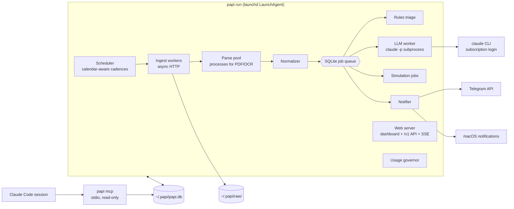

# 09 — Local Runtime & Infrastructure

> Parent: [PRD.md](../../PRD.md) · Used by all subsystem docs

## 1. Shape

One Python application, one long-running process, one SQLite file, one directory of raw files, all on my Mac. A second short-lived process (the MCP server) is started by Claude Code on demand and reads the same DB.



## 2. Technology decisions

| Concern | Decision | Rationale | Exit path |
|---|---|---|---|
| Language | **Python 3.12+**, managed with `uv` | Best ecosystem for HTTP scraping, PDF/OCR/XBRL, quant, and Claude CLI orchestration; one language for everything | Hot spots can become separate services later |
| Database | **SQLite (WAL)** via SQLAlchemy Core + Alembic | Zero ops, single file, trivial backup; easily handles ~150k disclosures/yr and ~600 tickers × daily bars | Same repository layer on PostgreSQL (+ Timescale/pgvector) if multi-user or hosted |
| Queue / bus | SQLite job table + outbox behind an `EventBus` interface | No extra daemon | NATS/Redis/Kafka behind the same interface |
| Raw storage | Content-addressed files under `~/.papi/raw/` | Simple, inspectable | S3-compatible store, same keys |
| Web | **FastAPI** + Jinja2 templates + **HTMX** + SSE; charts with a vendored JS library (e.g. Apache ECharts) | One language, no frontend build step | API is versioned; a React/Next.js client can replace templates later |
| Validation / contracts | JSON Schema files in `contracts/` as source of truth → pydantic models generated | Same schemas feed `claude --json-schema` and the DB layer | TS codegen added if a JS client appears |
| HTTP | `httpx` (async), global per-host rate limiter, circuit breaker | Politeness requirements in [02](02-ingestion-pipeline.md) | — |
| PDF / OCR | `pdfplumber`/`pypdf` for text and tables; `ocrmypdf` + Tesseract `tur` only when there is no text layer | Proven, local | — |
| XBRL | A Python XBRL parser (Arelle if needed for the KAP taxonomy; lighter parser if sufficient) | Decided in M3 after inspecting real KAP XBRL | — |
| Quant | `polars`/`pandas`, `statsmodels`, `lightgbm` (quantile), conformal wrapper | Standard | — |
| LLM | **Claude Code CLI** (`claude -p`) via `LlmBackend` ([04 §5](04-agents.md#5-claude-code-cli-backend)) | Uses the existing subscription | Anthropic API / other backends behind the same interface |
| MCP | Python MCP SDK, stdio | Native Claude Code integration | — |
| Secrets | macOS Keychain via `keyring` (Telegram token, optional API bearer token) | Not in files or repo | Secret manager when hosted |
| Config | `~/.papi/config.toml` (cadences, caps, channels, paths, model per task) | One place | — |

## 3. Repository layout

```
papi/
  pyproject.toml
  src/papi/
    cli.py                 papi init | run | mcp | backfill | reparse | eval | llm pause/resume | portfolio …
    core/                  entities, repository, event bus, jobs, calendar, config
    sources/kap/           KapClient interface, KapPublicWebClient, parsers per template
    sources/prices/        isyatirim, yahoo, cross-check
    sources/legal/         manifest fetcher, structure parser
    triage/                taxonomy mapping, priority, rules materiality
    llm/                   LlmBackend, ClaudeCodeCliBackend, governor, prompts/, context packs
    verify/                deterministic verifier
    sim/                   calculators, event studies, models, outcomes, position impact
    portfolio/             transactions, CSV template import, reconcile, corporate-action application
    notify/                telegram, macos, digest
    web/                   FastAPI app, templates, static (vendored JS)
    mcp/                   MCP server
  contracts/               JSON Schemas (events, payloads, analyst I/O), taxonomy
  packs/tr/                KAP subject→taxonomy map, form-template specs, calendars, legal manifest
  tests/                   unit, fixtures (recorded KAP payloads), golden sets
  docs/                    PRD, ADRs
```

## 4. Process lifecycle on macOS

| Concern | Approach |
|---|---|
| Start/stop | `launchd` LaunchAgent (`~/Library/LaunchAgents/com.papi.run.plist`, `RunAtLoad`, `KeepAlive`); `papi service install/uninstall` writes it |
| Logs | Structured JSON lines to `~/.papi/logs/`, rotated |
| Sleep | macOS suspends the process; on resume, papi detects the wall-clock jump and triggers catch-up ([02 §3.1](02-ingestion-pipeline.md#31-polling-and-catch-up)) |
| Stay awake (optional) | `prevent_sleep_on_ac = true` runs `caffeinate -s` (prevents system sleep only on AC power) while the trading calendar says the market is open |
| Claude CLI | Must be logged in with my subscription; papi checks `claude --version` and auth status at start and alerts if not usable |
| Crash safety | Jobs are leased with timeouts; an unfinished job is re-run (idempotent) after restart |

## 5. Storage & backups

| Item | Policy |
|---|---|
| `papi.db` | Nightly online backup (`sqlite3 .backup` API) to `~/.papi/backups/`, keep 14 daily + 8 weekly |
| `raw/` | Write-once files; included in Time Machine; optional rsync to an external disk |
| Disk budget | Measured in M1. Attachments dominate (tens of GB/year if every attachment is fetched; to be confirmed). Config `attachments.fetch_policy`: `all` for live, `prioritized` for backfill (holdings/watchlist/selected families eagerly, others on demand) |
| Restore drill | `papi restore --from backups/<date>` tested once per milestone |

## 6. Observability

No metrics stack. Metrics and health go to SQLite tables, surfaced on the Ops page ([07 §3.8](07-dashboard.md#38-ops--review)) and as Telegram ops alerts:

- ingest latency, last successful poll, gaps, failed jobs, drift
- queue depth by priority, Claude ledger vs. caps, governor state
- price cross-check mismatches
- backup success

## 7. Security

- Web/API bound to loopback; nothing listens on external interfaces.
- Claude pipeline calls have no tools and no MCP, and run in an empty sandbox dir ([04 §5.1](04-agents.md#51-invocation)).
- Disclosure text is treated as untrusted input everywhere (prompt delimiting, HTML sanitising in the UI).
- Secrets in the Keychain; the repo contains no personal data (portfolio lives only in `~/.papi/`).

## 8. Future hosting path (not planned, kept open)

| Step | What changes |
|---|---|
| Always-on box (mini PC / Raspberry Pi 5 / home server) | Same package; launchd → systemd; copy `~/.papi/`; log in Claude Code CLI on that machine |
| Phone access to dashboard | Tailscale; enable API bearer token |
| VPS | Same as always-on, plus disk encryption. Personal-use boundaries still apply ([10](10-usage-boundaries.md)) |
| Multi-user / public | See [10 §5](10-usage-boundaries.md#5-if-papi-ever-goes-beyond-personal-use): Postgres, real bus, auth, licences, legal review |

## 9. Acceptance criteria

- [ ] `uv tool install .` (or `uv run papi`) + `papi init` + `papi service install` gives a running system on a clean Mac.
- [ ] Reboot → papi starts by itself and catches up.
- [ ] Restore from backup reproduces the dashboard state.
- [ ] An 8-hour sleep followed by wake triggers catch-up without manual action.
