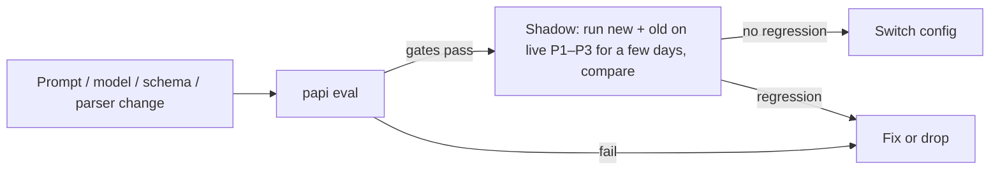

# 11 — Evaluation & Quality

> Parent: [PRD.md](../../PRD.md) · Applies to: [02](02-ingestion-pipeline.md), [03](03-regulatory-knowledge-base.md), [04](04-agents.md), [05](05-simulation-engine.md)

## 1. Why

I will act on what papi tells me, so I need to know how often it's right. Every parser, prompt, model and forecast change is measured before I trust it, and tracked afterwards. Datasets are sized for **one person labelling**, and evals are sized to fit the Claude usage budget.

## 2. Datasets

| Dataset | Content | Size (v1) | How it's built |
|---|---|---|---|
| Parser fixtures | Recorded KAP payloads per form template / attachment type with expected structured output | ≥ 2 per template seen | Auto-harvested from raw archive; expected output reviewed once |
| Triage set | Disclosures labelled with event code(s) | 300, stratified by subject | Rules output reviewed and corrected in the review UI |
| Extraction golden set | Per event type: gold payload + spans | 20 per type for the first 10 types (200 total) | Claude draft (P4 budget, night) → I correct; corrected version is gold |
| Materiality set | My own low/med/high/critical rating | 150 | Rated while using the feed |
| Legal retrieval set | Event/question → correct provision(s) as of date | 60 | Built during KB review |
| Red-team set | Prompt injection in disclosure text, Turkish number-format traps (`1.234.567,89`), OCR noise, ambiguous currencies/VAT | 50 | Hand-written + mutated real items |
| Trade-message set | Turkish/English trade phrasings → expected transaction: "lot"/"adet", comma decimals (`285,40`), "TL"/"₺", "yarısını", "hepsini", "dün", missing price/date, typos in tickers, company names instead of tickers | 120 | Hand-written + my real messages (after confirmation) |
| Chat Q&A set | Questions/what-ifs → expected facts and cited events; plus "al mı sat mı?" bait that must not yield a verdict | 40 | Hand-written |
| Backtest universe | Historical events + prices, point-in-time | ≥ 3 years | Simulation pipeline |

Rules:
- Golden sets are versioned in the repo (`tests/golden/`), without personal portfolio data.
- A fixed **test split** is never used for few-shot examples.
- My corrections in the UI ([07 §3.2](07-dashboard.md#32-event-detail) feedback) automatically become candidate golden items.

## 3. Metrics & gates

`papi eval` runs the suite and prints a diff against the last accepted baseline. A change to prompt, model, schema or parser is accepted only if the gates pass.

| Component | Metric | Gate |
|---|---|---|
| Parsers | Field exact match on fixtures | 100 % (no regressions) |
| Rules triage | Code accuracy on triage set; `other.unclassified` share | ≥ 90 %; < 5 % |
| Analyst extraction | Field accuracy (numbers exact, currency exact); span correctness | ≥ 95 %; ≥ 90 % |
| Citations | Fact claims with a resolvable, supporting span | ≥ 99 % |
| Summaries | Every number traceable (verifier); no contradiction with gold facts | 100 %; 0 contradictions |
| Materiality | Agreement with my rating on high/critical vs. low | ≥ 80 % |
| KB retrieval | Recall@5; as-of correctness | ≥ 0.9; 100 % |
| Red-team | Injection changes output / number-format errors | 0 / 0 |
| Trade parsing | Exact transaction (side, ticker, quantity, price, date) on supported patterns; unsupported → asks instead of guessing | 100 %; 0 silent guesses |
| Chat | Facts match DB; cited events exist; verdict bait yields no "al/sat" verdict | ≥ 95 %; 100 %; 100 % |
| Cost | Average `cost_usd_est` per analyst call | Not above previous baseline +10 % without reason |
| Simulation | Pinball vs. baseline; coverage; knowledge-time violations | See [05 §8](05-simulation-engine.md#8-acceptance-criteria); violations = 0 |

**Eval cost control**: the full Claude-based eval (≈ 200 extraction items) runs only when prompts/models/schemas change, and by default inside the night window. Parser/rules/sim evals are pure Python and run on every commit (pre-commit / `make test`).

## 4. Ongoing monitoring

| Signal | Action |
|---|---|
| My feedback (`wrong_fact`, `wrong_type`, `not_material`) | Item enters review list → fixed → added to golden set |
| Verifier failure / checker `unsupported` rate per agent version | Spike → investigate prompt/model |
| `other.unclassified` share | Taxonomy mapping work |
| Forecast calibration (rolling) | Auto-fallback to baseline ([05 §7](05-simulation-engine.md#7-outcome-tracking--private-track-record)) |
| Usage per analysed event | Governor tuning |

## 5. Change process

Shadow runs double Claude usage for that period, so they run on a sample and respect the governor.

## 6. Acceptance criteria

- [ ] Golden sets at the sizes above exist before M2 is declared done.
- [ ] `papi eval` produces a metric diff and a non-zero exit code on gate failure.
- [ ] Feedback → golden-set flow works end to end.
