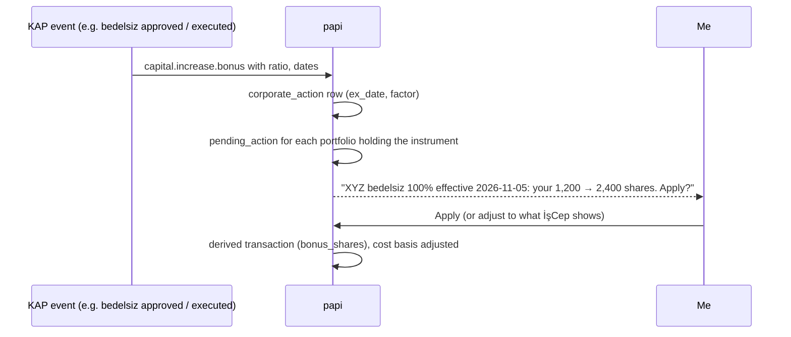

# 12 — Portfolio

> Parent: [PRD.md](../../PRD.md) · Entities: [06 §8](06-data-model.md#8-portfolio--personal-entities) · Impact maths: [05 §5](05-simulation-engine.md#5-l4--position--portfolio-impact) · UI: [07](07-dashboard.md)

## 1. Purpose

papi's priority system, alerts and "For me" analysis all depend on knowing what I hold. The portfolio module keeps an accurate, point-in-time record of holdings, including the share-count changes that BIST corporate actions cause (bedelsiz, bedelli, splits, dividends).

## 2. Inputs

| Input | Method |
|---|---|
| Telegram message | "THYAO 100 lot 285,40'tan aldım" → confirmation card → ✅ ([08 §4.3](08-local-api-mcp-and-notifications.md#43-trade-recording)). **The everyday path.** |
| Manual entry | `papi portfolio add BUY THYAO 100 @ 285.40 2026-10-01 --fees 4.2` or the UI form |
| Bulk load (CSV template) | papi's own CSV format (`ticker,type,quantity,price,date,fees,note`), filled by hand once from İşCep → `papi portfolio import holdings.csv`; preview + dedupe before commit |
| Reconcile with İşCep | `papi portfolio reconcile` (or UI form): I type the quantities İşCep shows; papi lists differences and proposes `reconcile_adjustment` entries or points to a missing transaction / pending action |
| Opening balance | One-off `opening_balance` entries ("position as of date") for history I don't want to re-enter |
| Watchlist | Tickers, sectors (e.g. defence, banks) and indices (XU030) to follow without holding |

**İşCep is not integrated.** There is no integration papi can use, and papi never logs in to my bank/brokerage account or scrapes statements ([10 B-2](10-usage-boundaries.md#1-scope-rules)). Brokerage credentials never touch papi. Right after a trade in İşCep, I send papi a one-line Telegram message, and the weekly review reminds me to reconcile.

Transactions are **append-only**. Mistakes are fixed with reversing entries, so history stays auditable.

## 3. Corporate actions → holdings

| Action | Effect on holding |
|---|---|
| Bonus issue (bedelsiz) | Quantity × (1 + b); total cost unchanged; per-share cost ÷ (1 + b) |
| Rights issue (bedelli) | Pending choice: subscribe (cash out `n·r·S`, quantity × (1 + r)) or sell/lapse rights |
| Cash dividend | Cash income (gross, withholding, net) recorded; quantity unchanged |
| Split / reverse split | Quantity and per-share cost scaled |
| Ticker change / merger | Identifier mapping; position carried over or converted per terms |

Nothing is applied silently. papi proposes and I confirm against İşCep, because broker practice (fractions, rounding, dates) can differ.

## 4. Valuation & exposure

| Measure | Definition |
|---|---|
| Position value | Quantity × latest close (EOD; labelled with date) |
| P&L | Realised/unrealised in TRY; also in USD (TCMB rate) and inflation-adjusted (TÜİK CPI), because TRY nominal P&L misleads |
| Weights | Position / total; sector weights; index-member share |
| Event exposure | Positions with open regulatory timelines; positions with high-materiality events in the last N days |
| Concentration | Top-N weight, sector concentration |

All valuation is point-in-time (`position_snapshot` as of date) so history views are correct.

## 5. Portfolio page

| Block | Content |
|---|---|
| Holdings table | Ticker, quantity, avg cost, last close, value, weight, P&L (TRY/USD/real), last event badge |
| Event timeline | All events on holdings, newest first, with materiality and position impact range |
| Open timelines | Per holding: current step, typical remaining duration (from [05 §3](05-simulation-engine.md#3-l2--regulatory-timeline)) |
| Pending actions | Corporate actions waiting for confirmation |
| Scenario summary | Open forecasts on holdings: aggregated T+5 range via joint bootstrap ([05 §5](05-simulation-engine.md#5-l4--position--portfolio-impact)) |
| Track record | How past forecasts on my holdings scored |

## 6. Priority wiring

| Portfolio state | Triage priority |
|---|---|
| Instrument held (quantity > 0) | P1 |
| On watchlist or in a watched sector/index | P2 |
| Previously held within N days (configurable) | P2 (follow-through on things I just sold) |

Priority is evaluated at event time using the point-in-time position.

## 7. Acceptance criteria

- [ ] Rebuilding positions from transactions matches İşCep quantities for every holding (`papi portfolio reconcile` shows zero differences).
- [ ] A historical bonus issue in my history produces a correct pending action and, after confirmation, a correct quantity and cost basis.
- [ ] CSV template import is idempotent (re-import adds nothing).
- [ ] Weekly review message includes a "reconcile with İşCep" reminder with the current papi quantities.
- [ ] Holding changes take effect in triage priority immediately.
